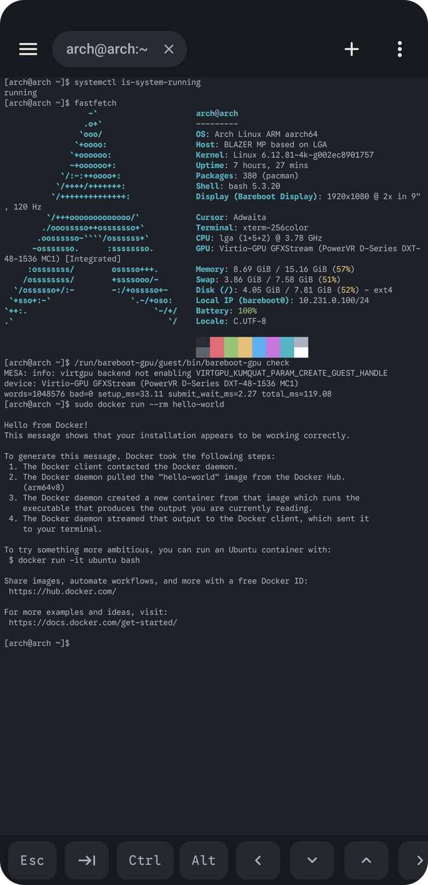

# Bareboot

Your Android phone already runs Linux. Bareboot runs ARM64 distributions directly on that kernel without a VM, emulation, or binary translation, using ext4 images, Linux namespaces, and a root daemon.

  
  &#8194;
  

- Debian, Ubuntu, Arch, Fedora, Alpine, openSUSE, Kali, Void
- systemd and Docker
- Terminal powered by `libghostty`. Reopen running shells after closing the app, search scrollback, and switch color themes.
- SSH, shared folder with Android
- Linux apps in desktop windows over USB. Vulkan and OpenGL run on the phone's GPU. Experimental; tested on macOS.

## Requirements

- ARM64 phone rooted with KernelSU or Magisk
- Android 11+, SELinux Enforcing, and a kernel with `SO_PEERPIDFD` (Linux 6.1 needs a backport)

systemd and Docker also need a kernel with PID namespaces. See [kernel features](docs/kernel.md).

## Install

1. Install `bareboot-module.zip` in KernelSU or Magisk.
2. Install the APK and open it.
3. If asked, tap **Action** on the Bareboot module.
4. Pick a distribution.

No release yet; build with `./build.sh`.

## Docs

- [Install](docs/install.md)
- [Usage](docs/usage.md)
- [Docker](docs/docker.md)
- [GUI apps](docs/desktop.md)
- [Kernel features](docs/kernel.md)
- [How it works](docs/architecture.md)
- [Security](docs/security.md)
- [Development](docs/development.md)

## License

[Apache 2.0](LICENSE)
