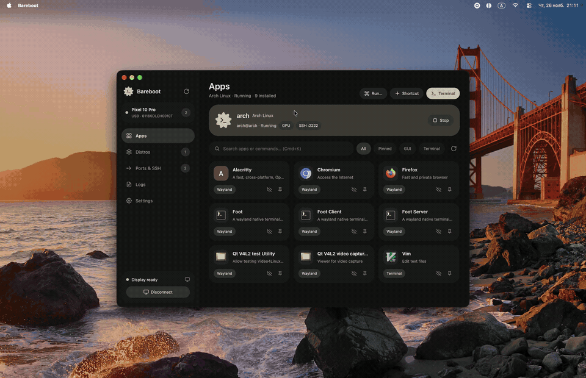

# Bareboot

Run Linux distributions directly on kernel without a VM, emulation, or binary translation.

  
  &#8194;
  
  &#8194;
  

## Features
- Debian, Ubuntu, Arch, Fedora, Alpine, openSUSE, Kali, Void out of box (You can also bring your image)
- systemd, Runit, OpenRC and Docker
- Terminal powered by `libghostty`
- Shells survive closing the app
- SSH via USB or Wi-Fi, shared folder with Android

## Desktop companion

  

Run Linux GUI apps from your phone as native windows on macOS, Linux, or Windows (like WSLg), with Vulkan and OpenGL accelerated by the phone's GPU.

- Launch installed apps in one click over USB or Wi-Fi ADB
- Start and stop distributions, inspect logs, and push files to `/mnt/android`
- Forward ports and open shells or USB SSH in your own terminal

See [Desktop companion](docs/desktop.md) for setup.

## Requirements

- ARM64 phone rooted with KernelSU or Magisk
- Android 11+ with SELinux Enforcing
- Linux 6.5+ kernel (Android GKI 6.6+, or an older kernel with `SO_PEERPIDFD` backported)

systemd and Docker also need a kernel with PID namespaces. See [kernel features](docs/kernel.md).

## Install

1. Install `bareboot-module.zip` in KernelSU or Magisk.
2. Install the APK and open it.
3. If asked, tap **Action** on the Bareboot module.
4. Pick a distribution.

No release yet; build with `./build.sh`.

## Docs

- [Install](docs/install.md)
- [Usage](docs/usage.md)
- [Docker](docs/docker.md)
- [Desktop companion & GUI apps](docs/desktop.md)
- [Kernel features](docs/kernel.md)
- [How it works](docs/architecture.md)
- [Security](docs/security.md)
- [Development](docs/development.md)

## License

[Apache 2.0](LICENSE)
