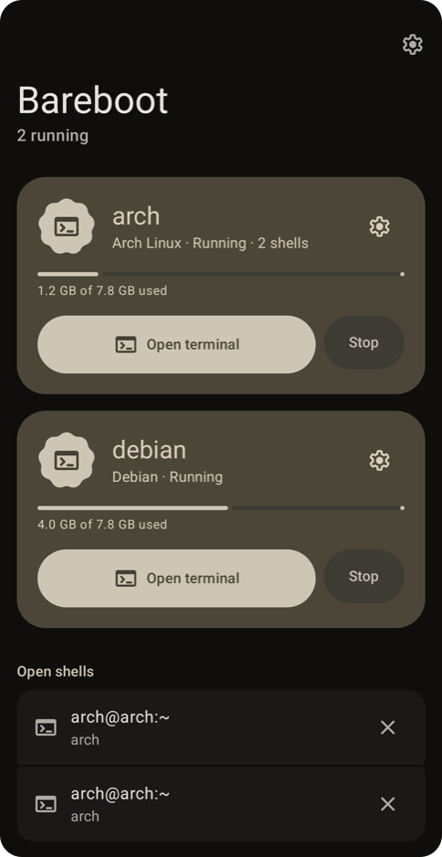
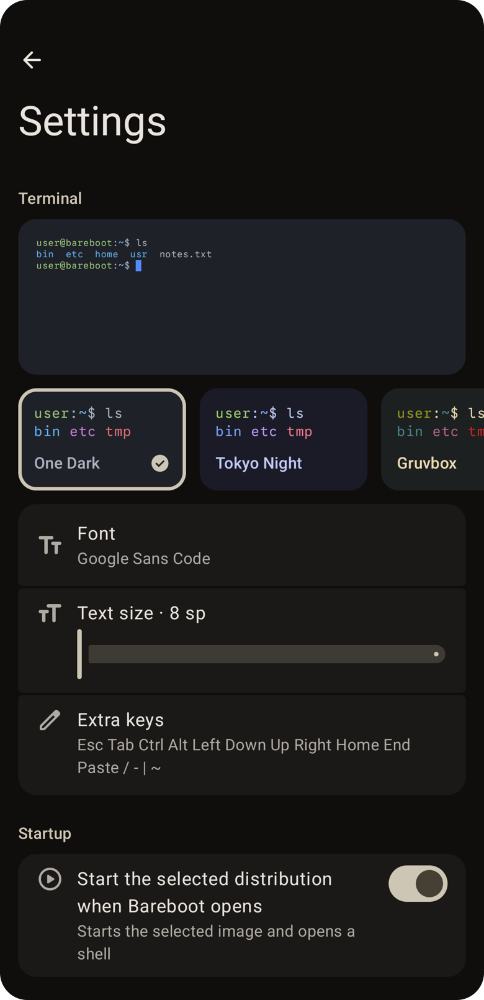

# Bareboot

Run Linux distributions directly on kernel without a VM, emulation, or binary translation.

  
  &#8194;
  
  &#8194;
  

## Features
- Debian, Ubuntu, Arch, Fedora, Alpine, openSUSE, Kali, Void out of box (You can also bring your image)
- systemd, Runit, OpenRC and Docker
- Terminal powered by `libghostty`
- Shells survive closing the app
- SSH via USB or Wi-Fi, shared folder with Android

## Desktop companion

  

Run Linux GUI apps from your phone as native windows on macOS, Linux, or Windows (like WSLg), with Vulkan and OpenGL accelerated by the phone's GPU.

- Launch installed apps in one click over USB or Wi-Fi ADB
- Start and stop distributions, inspect logs, and push files to `/mnt/android`
- Forward ports and open shells or USB SSH in your own terminal

See [Desktop companion](docs/desktop.md) for setup.

## Benchmarks

Same static `aarch64-unknown-linux-musl` binary ([`tools/bench`](tools/bench)) on a Pixel 10 Pro (Tensor G5, Android 17, Linux 6.12, 8 cores, median of 5 trials, foreground `top-app`):

| Benchmark | Unit | Bareboot | Termux |
| --- | --- | ---: | ---: |
| SHA-256 (1 thread) | MiB/s (higher) | 303.7 | 304.7 |
| SHA-256 (all threads) | MiB/s (higher) | 1,500 | 1,512 |
| Integer sort (250k u64) | M elem/s (higher) | 94.78 | 95.03 |
| FP64 matmul (256x256) | GFLOP/s (higher) | 13.55 | 13.71 |
| Memory copy (64 MiB) | GiB/s (higher) | 25.21 | 25.39 |
| Pointer chase (64 MiB) | ns/load (lower) | 102.6 | 96.95 |
| Syscall (getppid) | ns/call (lower) | 91.15 | 91.98 |
| Process spawn (exec) | ms/spawn (lower) | 0.56 | 2.21 |
| Pipe IPC ping-pong | us/RTT (lower) | 2.92 | 3.07 |
| Small files (1000x4K CRUD) | files/s (higher) | 70,595 | 47,248 |
| Seq write + fsync (64 MiB) | MiB/s (higher) | 436.3 | 100.8 |
| Random 4K I/O (75R/25W) | kIOPS (higher) | 1,090 | 1,084 |

Bareboot matches native Termux on compute, memory, syscalls, and IPC while running unmodified Linux distributions. See [Benchmarks](docs/benchmarks.md) for min-max ranges, methodology, and commands to reproduce on your own device.

## Requirements

- ARM64 phone rooted with KernelSU or Magisk
- Android 11+ with SELinux Enforcing
- Linux 6.5+ kernel (Android GKI 6.6+, or an older kernel with `SO_PEERPIDFD` backported)

systemd and Docker also need a kernel with PID namespaces. See [kernel features](docs/kernel.md).

## Install

1. Install `bareboot-module.zip` in KernelSU or Magisk.
2. Install the APK and open it.
3. If asked, tap **Action** on the Bareboot module.
4. Pick a distribution.

No release yet; build with `./build.sh`.

## Docs

- [Install](docs/install.md)
- [Usage](docs/usage.md)
- [Docker](docs/docker.md)
- [Desktop companion & GUI apps](docs/desktop.md)
- [Kernel features](docs/kernel.md)
- [Benchmarks](docs/benchmarks.md)
- [How it works](docs/architecture.md)
- [Security](docs/security.md)
- [Development](docs/development.md)

## License

[Apache 2.0](LICENSE)
