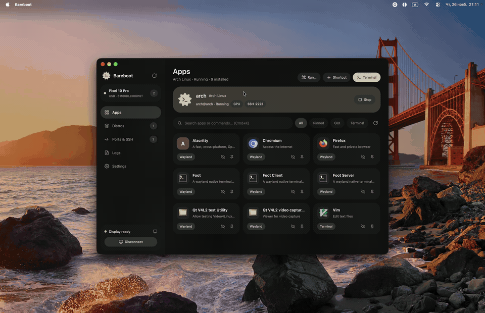

# Desktop companion & GUI apps

Bareboot Desktop is a cross-platform GPUI companion app (`tools/desktop`, macOS, Linux, and Windows) that connects to your phone over ADB (USB or Wi-Fi). Linux GUI apps open as native windows on your computer, with Vulkan and OpenGL running on the phone's GPU.

<p align="center">
  <a href="images/readme-desktop.gif"></a>
</p>

## What it does

- Scans `/usr/share/applications` and `~/.local/share/applications` inside the running distribution, caches app icons, and lets you search (`Cmd+K` / `Ctrl+K`), pin, hide, or add custom shortcuts. Clicking a GUI app starts the distribution and Wayland display automatically.
- Starts and stops images, displays disk usage, sends files to `/mnt/android`, and edits startup settings (GPU, init, isolated network, SSH port, port forwards).
- Opens shells in your host terminal (Ghostty, iTerm2, Kitty, Alacritty, WezTerm, Warp, Terminal.app, Foot, GNOME Terminal, Konsole, Windows Terminal) over direct ADB shell or USB SSH, and manages `adb forward` tunnels.
- Reads `daemon`, `autostart`, and `sshd` logs and shows kernel capabilities on the connected phone.
- Decodes per-window H.264/HEVC streams on the host GPU (`VideoToolbox` / `CALayer` on macOS, OpenGL / VAAPI / D3D11VA on Linux and Windows) with auto-reconnect and optional macOS `Cmd -> Ctrl` key remapping.

## Setup

On Apple Silicon, unzip `bareboot-desktop-macos-arm64.zip` and move `Bareboot.app` into `/Applications`. Install `adb` and FFmpeg 9 (for example via Homebrew or Android SDK platform-tools). Build and install from source on macOS with:

```sh
bash tools/desktop/package-macos.sh install
```

Allow root for ADB Shell in KernelSU or Magisk. If multiple devices or USB and Wi-Fi transports are connected, switch between them in the sidebar.

The root module includes the GPU bundle by default, and images start with GPU acceleration when available. To disable it for an image, stop the image and toggle **GPU acceleration** in its settings.

## Run from source

Install Rust and the FFmpeg development libraries, then run:

```sh
cargo run --release --manifest-path tools/desktop/Cargo.toml
```

To run the headless Wayland display host directly from the command line without the companion UI:

```sh
cargo run --release --manifest-path tools/desktop/Cargo.toml -- arch
```

Verify guest GPU acceleration inside a distribution with `/run/bareboot-gpu/guest/bin/bareboot-gpu check`.

## Limits

- No clipboard sharing between host and guest Wayland windows yet
- Pointer cursor is always an arrow
- US keyboard layout in remote Wayland windows
- Linux and Windows desktop builds are not yet hardware-tested
- On Adreno drivers without dma-buf import, the renderer exports host-visible Vulkan memory through Android hardware buffers. OpenGL through Zink requires `VK_KHR_maintenance5`.
